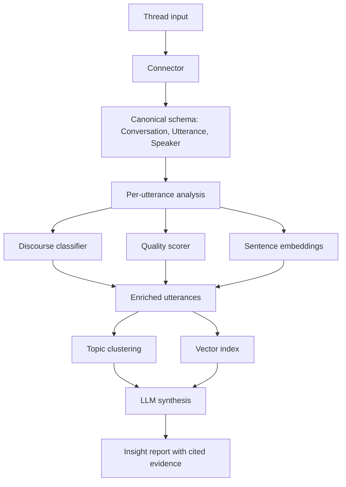

# Discussion Intelligence Toolkit

An open-source Python toolkit for turning long asynchronous discussions into structured, evidence-linked insight reports.

This repository is both the team’s working project space and the final public portfolio artifact. Students will build the package, notebooks, experiments, evaluation results, documentation, and final report here throughout Break Through Tech AI Studio Fall 2026. Keep this README current as the project evolves; by December, it should read as the project’s public technical report.

## Results So Far

Results through Notebook 06 (October 2026):

| Component                     |                       Best result | Evaluation                                                                        |
| ----------------------------- | --------------------------------: | --------------------------------------------------------------------------------- |
| Discourse-act baseline        |                Macro F1 **0.373** | Class-balanced TF-IDF; development split; majority baseline 0.066                 |
| Reply civility baseline       | Macro F1 **0.622**; AUC **0.664** | Official CGA-CMV test split                                                       |
| Conversation-quality baseline | Macro F1 **0.611**; AUC **0.656** | Civility/derailment; official CGA-CMV test split                                  |
| Embedding comparison          |                BGE-small selected | Best quality/cost tradeoff; MPNet had the highest sampled derailment AUC at 0.585 |
| Preliminary clustering        |             Silhouette ≈ **0.02** | KMeans was insufficient; improved method needed                                   |

The quality baseline currently measures civility. Relevance, reasoning, and constructiveness will be added before producing an aggregate quality score. Results use different datasets and evaluation protocols and are not a shared leaderboard.

## Start Here

1. Read `Challenge-Project-Overview.md` for the full challenge brief, milestones, and advisor expectations.
2. Create or review the GitHub Projects board for monthly milestone tracking.
3. Use `notebooks/` for exploration, modeling, and demo notebooks.
4. Use `data/` only for small metadata files or documented pointers. Do not commit large raw datasets, model checkpoints, API keys, or `.env` files.
5. Track setup blockers, modeling decisions, and evaluation questions as GitHub issues.
6. Update this README whenever the team changes datasets, modeling approach, metrics, or project scope.

## What We Are Building

Long Reddit, forum, Discord, GitHub, and community discussions contain product, research, and operational signal that is expensive to extract manually. This project builds a Python toolkit that ingests threaded conversations and produces structured reports showing:

- the main claims and arguments in a discussion
- the comments that support each claim
- discourse-act labels such as question, answer, agreement, disagreement, humor, and elaboration
- argument-quality or discussion-quality scores
- discovered topic clusters
- retrieval-grounded LLM summaries that cite evidence from the source thread

The intended December deliverable is a real installable toolkit, not a one-off notebook. A successful project should be understandable, runnable, and extensible by someone outside the team.

## Project Architecture



Training happens once on labeled corpora. Inference should run on new threads without retraining. The connector layer keeps source-specific parsing separate from the rest of the toolkit, so a future contributor can add Hacker News, GitHub Discussions, Discord exports, or another threaded source without rewriting the pipeline.

## Repository Map

| Path                             | Purpose                                                                                                                       | Owner                       |
| -------------------------------- | ----------------------------------------------------------------------------------------------------------------------------- | --------------------------- |
| `Challenge-Project-Overview.md`  | Challenge brief, milestones, resources, advisor expectations                                                                  | Challenge Advisor           |
| `Getting-Started-for-Fellows.md` | BTT orientation and initial repo guidance                                                                                     | Challenge Advisor / Fellows |
| `README.md`                      | Living project home, progress log, and final portfolio artifact                                                               | Fellows                     |
| `notebooks/`                     | EDA, modeling, evaluation, and demo notebooks                                                                                 | Fellows                     |
| `artifacts/`                     | Reusable schema, feature, evaluation, quality, and embedding modules                                                          | Fellows                     |
| `tests/`                         | Automated tests for reusable project modules                                                                                  | Fellows                     |
| `data/`                          | Small metadata files, data dictionaries, or links to external datasets                                                        | Fellows                     |
| `pyproject.toml` / `uv.lock`     | Python package metadata, dependency groups, and locked environment once package scaffolding is added                          | Fellows                     |
| `requirements.txt`               | Legacy scaffold file from the template; migrate dependencies to `pyproject.toml` and `uv.lock` before adding project packages | Fellows                     |
| `.gitignore`                     | Files that must stay out of version control                                                                                   | Fellows                     |

As the toolkit grows, use package and test directories such as `src/` and `tests/` rather than keeping production code only in notebooks.

## Team Members

| Name             | GitHub Handle                                                                           | Primary Contribution |
| ---------------- | --------------------------------------------------------------------------------------- | -------------------- |
| Tiffany Calle    | [@TiffanyCalle](https://github.com/TiffanyCalle)                                        | TBD                  |
| Ravi Chahal      | [@RavjeetChahal](https://github.com/RavjeetChahal)                                      | TBD                  |
| Thomas Di Maggio | [@tdmagg](https://github.com/tdmagg)                                                    | TBD                  |
| Norah Haque      | [@norahhaque](https://github.com/norahhaque)                                            | TBD                  |
| Isaiah Mak       | [@ShinyRayquay](https://github.com/ShinyRayquay) / [@IsaMak](https://github.com/IsaMak) | TBD                  |
| Jay Timbol       | [@jctimbol](https://github.com/jctimbol)                                                | TBD                  |
| Daniel Voyevoda  | [@dvoyevoda](https://github.com/dvoyevoda)                                              | TBD                  |

Update this table as responsibilities become clear. Contributions should name concrete ownership such as connector implementation, EDA, model training, evaluation harness, packaging, documentation, or final demo.

## Project Highlights

- Standardized two labeled corpora under one schema.
- Established discourse and civility-based quality baselines.
- Selected BGE-small as the default embedding model.
- **November integration results: TBD.**
- **December final evaluation and demo: TBD.**

## Setup and Installation

Use `uv` for local Python environments, dependency management, and project commands. Do not install project dependencies with `pip` directly.

```bash
git clone https://github.com/Break-Through-Tech/Other-AI_Powered_Discussion_Intelligence_Toolkit.git
cd Other-AI_Powered_Discussion_Intelligence_Toolkit
uv sync
uv run python -m ipykernel install --user --name discussion-intelligence
```

Once the package structure exists, common commands should use `uv run`:

```bash
uv run pytest
uv run python -m discussion_intelligence
```

For Colab, keep notebook setup cells aligned with the locked `uv` environment. If Colab needs one-off install cells before the package is fully scaffolded, mirror every dependency in `pyproject.toml` and refresh `uv.lock` locally so the repo remains reproducible.

## Development Workflow

- Use GitHub issues for tasks, questions, bugs, and experiment follow-ups.
- Use branches for substantial changes.
- Use `uv add`, `uv remove`, `uv sync`, and `uv run` for Python dependency and command workflows.
- Keep notebooks runnable from top to bottom.
- Move reusable code from notebooks into Python modules when it is used in more than one place.
- Record major design decisions in this README or a linked design note.
- Do not commit raw bulk data, private credentials, `.env` files, generated model checkpoints, or local cache directories.
- Prefer measured comparisons over intuition when choosing models, prompts, or preprocessing steps.

## Project Overview

Break Through Tech AI Studio teams will build an NLP system that extracts structured insight from online threaded conversations. The project combines supervised classification, regression or scoring, embedding-based clustering, retrieval, and LLM synthesis in one coherent pipeline.

The core design goal is transferability: students should finish with a package they can install, demo, explain in interviews, and extend after the program. The toolkit should expose clear contracts for conversation schemas, connectors, model components, and final reports.

## Data

Full corpora and embedding caches stay out of Git; see [`data/README.md`](data/README.md) and [`data/STANDARDIZATION.md`](data/STANDARDIZATION.md).

| Dataset                     |                                    Size | Use                      | Notes                                                                             |
| --------------------------- | --------------------------------------: | ------------------------ | --------------------------------------------------------------------------------- |
| Coarse Discourse            | 9,483 conversations; 115,827 utterances | Discourse classification | Median 9 utterances; no timestamps; synthetic repairs excluded from text training |
| CGA-CMV                     |  6,842 conversations; 42,964 utterances | Civility and derailment  | Median 6 utterances; official 4,106/1,368/1,368 split; matched pairs preserved    |
| Target-domain thread export |                                 **TBD** | End-to-end evaluation    | Must preserve `parent_id`                                                         |

Analysis: [01 — EDA](notebooks/01_standardized_corpora_eda.ipynb), [02 — text features](notebooks/02_text_features.ipynb), and [03 — structural features](notebooks/03_structural_features.ipynb).

## Model Development

Use a modeling ladder. Start with simple baselines, then add complexity only when evaluation shows the baseline is insufficient.

Recommended progression:

1. Majority-class or constant-score baseline.
2. TF-IDF plus logistic regression or linear regression.
3. Sentence-transformer embeddings plus a simple classifier, regressor, or clustering model.
4. Fine-tuned DistilBERT or another compact transformer for supervised tasks.
5. Retrieval-grounded LLM synthesis after evidence extraction and retrieval are working.

Experiments: [04 — discourse baseline](notebooks/04_comment_labeling_baseline.ipynb), [05 — quality baseline](notebooks/05_conversation_quality_baseline.ipynb), and [06 — embedding comparison](notebooks/06_embedding_comparison.ipynb).

| Future experiment              | Result  |
| ------------------------------ | ------- |
| Context-aware discourse model  | **TBD** |
| Aggregate quality model        | **TBD** |
| Topic clustering and retrieval | **TBD** |
| Integrated insight report      | **TBD** |

## Evaluation Plan

Use task-specific metrics. Do not rely on generic accuracy alone.

| Component                       | Primary metrics                                                                 | Status and purpose                                                                        |
| ------------------------------- | ------------------------------------------------------------------------------- | ----------------------------------------------------------------------------------------- |
| Discourse-act classifier        | Macro F1, per-class F1, confusion matrix                                        | Development baseline measured; final held-out test result **TBD**                         |
| Civility-based quality baseline | Accuracy, macro F1, ROC AUC, matched-pair accuracy                              | Held-out baseline measured in Notebook 05                                                 |
| Future aggregate quality scorer | Component metrics; MAE and Spearman correlation against human aggregate ratings | Requires relevance, reasoning, constructiveness, and human-rated validation data; **TBD** |
| Topic clustering                | Silhouette score and sampled cluster-coherence review                           | Preliminary KMeans silhouette ≈0.02 in Notebook 06; improved method **TBD**               |
| Retrieval                       | Recall@k on hand-written thread questions                                       | **TBD**                                                                                   |
| LLM synthesis                   | Claim coverage, evidence-link accuracy, hallucination rate                      | **TBD**                                                                                   |

For the final system, build a small held-out set of manually reviewed threads. Score final reports against human-written insight digests for claim coverage, evidence accuracy, and hallucination rate.

## Results and Key Findings

See [Results So Far](#results-so-far) for current metrics. Source notebooks: [01](notebooks/01_standardized_corpora_eda.ipynb), [02](notebooks/02_text_features.ipynb), [03](notebooks/03_structural_features.ipynb), [04](notebooks/04_comment_labeling_baseline.ipynb), [05](notebooks/05_conversation_quality_baseline.ipynb), and [06](notebooks/06_embedding_comparison.ipynb).

Future artifacts to add:

- final model comparison — **TBD**
- cluster and retrieval examples — **TBD**
- cited insight-report example — **TBD**
- final human-review metrics — **TBD**

## Final Demo Requirements

The final demo should show the complete path from input thread to structured report:

1. Load or ingest a threaded discussion.
2. Normalize it into the canonical conversation schema.
3. Run discourse, quality, embedding, clustering, and retrieval components.
4. Generate an insight report.
5. Show that each major claim links back to source comments.
6. Explain the evaluation results and remaining limitations.

The demo should run on student-accessible compute such as Google Colab.

## Milestones

| Month     | Focus                            | Expected Outcomes                                                                  |
| --------- | -------------------------------- | ---------------------------------------------------------------------------------- |
| September | Data understanding and baselines | EDA, cleaned schema, baseline models, initial evaluation harness                   |
| October   | Modeling                         | Discourse classifier, quality scorer, topic clustering, model comparisons          |
| November  | Integration                      | End-to-end `analyze(thread)` pipeline, retrieval, LLM synthesis, package structure |
| December  | Polish and presentation          | Final report, reproducible demo, recorded walkthrough, documented next steps       |

Status: September work and Notebooks 04–06 are complete; November and December results remain **TBD**.

## Next Steps

- Run final held-out discourse evaluation with context-aware features.
- Build relevance, reasoning, and constructiveness components for aggregate quality.
- Cache full-corpus BGE-small embeddings and improve clustering.
- Measure retrieval Recall@k on a small benchmark.
- Integrate and evaluate `analyze(thread)` on a parent-preserving target corpus.

## License

License decision pending advisor and program approval. Document the chosen license here before final publication.

## References

Add references as the team uses them. Expected categories:

- Break Through Tech AI Studio project materials
- ConvoKit documentation and papers
- Pushshift or Reddit dataset documentation
- Hugging Face Transformers documentation
- sentence-transformers documentation
- scikit-learn documentation
- papers or articles on discourse analysis, argument mining, retrieval-augmented generation, and grounded summarization

## Acknowledgements

Thank the Break Through Tech AI Studio program team, AI Studio Coach, Challenge Advisor, and contributors who supported the project.
